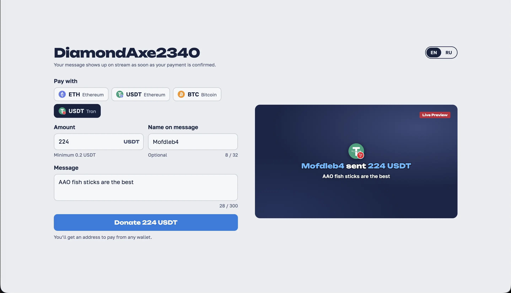
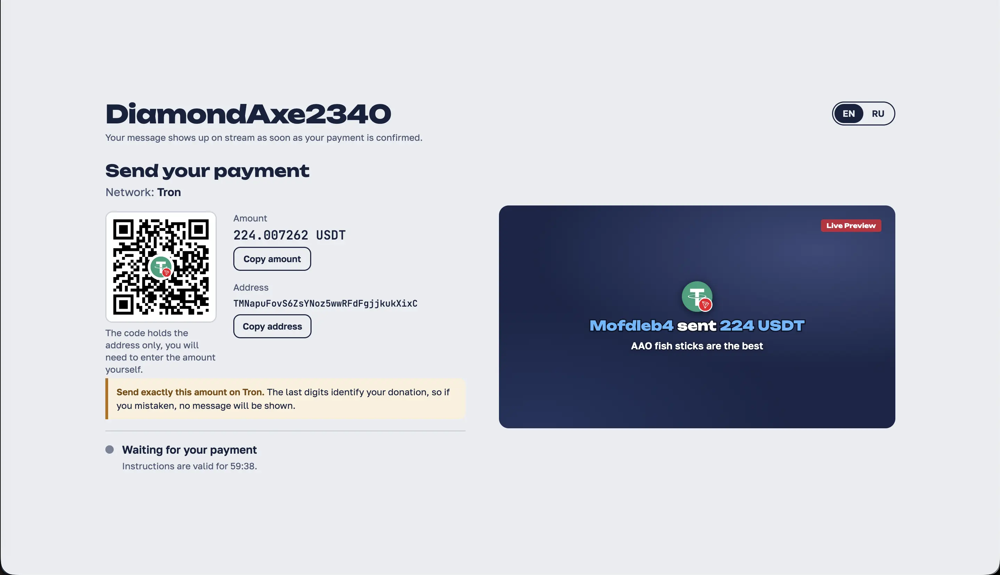

# crnpay

Self hosted crypto donations for streamers. Project aims to replicate traditional donation service functionality, but without additional fees for streamer. It is possible, because with crypto there is no payment processing logic, only watchers that use transaction data providers. Service includes main donate page, payment instructions page and real time alerts endpoint to embed into streaming software.

## Screenshots

### Donate page



### Payment instructions

Payment page shows real time updates on transaction status



## Configuration

You need to specify your wallet's public keys for selected tokens. The service never stores private keys.

[First setup](docs/configuration.md)

## Development

### Layout

```
src/
├── server/            the Node app
│   ├── donate/        donate and payment pages
│   ├── alerts/        OBS alert page and its event stream
│   ├── payments/      one adapter per chain, plus the watcher that polls them
│   ├── ui/            server-rendered components
│   ├── platform/      config, env, logging, storage and scheduling
│   └── test-support/  test helpers and fakes
├── client/            browser scripts for the donate and alert pages
│   └── styles/        their CSS
└── shared/            code both sides use: amounts, validation, translations, API types
docs/
├── adr/               technical decisions
└── domain/            donation and alert rules
design/                HTML prototypes the pages are based on
docker/                images and compose files
```

### Architecture

It's one small server per Streamer. It never holds a key that can spend money: it only knows public addresses and extended public keys, and it watches the chain for incoming Payments ([ADR-0001](docs/adr/0001-single-streamer-non-custodial.md)).

When a Donor submits the form, the server creates a Donation and works out how to recognise its Payment. On Bitcoin each Donation gets its own address, derived from the Streamer's zpub. On EVM chains and Tron everyone pays the same address, so each Donation gets its own exact amount instead ([ADR-0002](docs/adr/0002-matching-method-per-chain-family.md)).

Every 15 seconds a watcher asks a hosted provider for new transfers on each chain, using mempool.space, Etherscan or TronGrid, so you don't need to run your own nodes ([ADR-0003](docs/adr/0003-hosted-chain-data-providers.md)). Once a Payment has enough confirmations, an Alert is saved and pushed over server-sent events to the open Alert page. That page plays Alerts one at a time and reports each one back once it's been shown, so an Alert missed while OBS was closed gets replayed when it reconnects.

Pages are rendered on the server, with a little client script on top for the live preview and the payment status. State is kept in a single SQLite file. Rate limiting is left to the Caddy reverse proxy in front of the app ([ADR-0005](docs/adr/0005-rate-limit-at-proxy.md)).

### Stack

- **Runtime:** TypeScript on Node 26.
- **Web framework:** [Hono](https://hono.dev) handles routing, server-sent events and page rendering with JSX.
- **Storage:** SQLite through `better-sqlite3`, with plain SQL.
- **Chain data:** hosted providers instead of our own nodes: mempool.space for Bitcoin, Etherscan for EVM chains, and TronGrid for Tron.
- **QR codes:** `qrcode` draws the payment QR, with the token icon in the middle.
- **Validation:** `zod` checks config and input.
- **Logging:** `pino` writes the logs.
- **Translations:** FormatJS (`intl-messageformat`) handles UI text in English and Russian.
- **Crypto:** `@scure` and `@noble` libraries handle Bitcoin address derivation.
- **Client:** plain TypeScript bundled by esbuild, with no framework.
- **Tooling:** Vitest for tests, plus ESLint and Prettier.
- **Deployment:** Docker, with a custom Caddy image that adds rate limiting.

### Building

You'll need Node 26 and pnpm. Install dependencies and create your env and config files:

```bash
pnpm install
cp .env.example .env
```

Fill in `.env` and write `config.json` as described in the [configuration guide](docs/configuration.md), then start the dev server:

```bash
pnpm dev
```

The server restarts itself when server code changes. Browser scripts and CSS are built only once, at startup, so after changing them run `pnpm build:client` and reload the page.

Before committing, run the checks:

```bash
pnpm test
pnpm typecheck
pnpm lint
pnpm format
```

To run the full production setup locally, with the app and Caddy built from source:

```bash
docker compose -f docker/compose.yaml -f docker/compose.local.yaml up --build
```

## License

[MPL 2.0](LICENSE)
